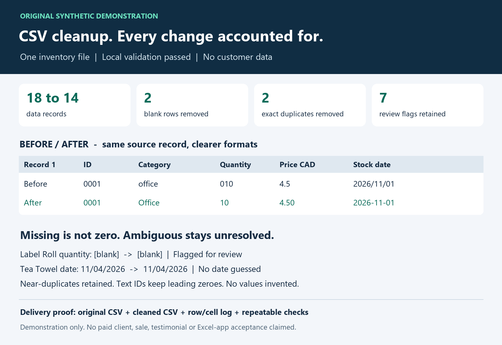

# Transparent CSV cleanup — tested example

A **self-directed synthetic demonstration**, not a customer order, review, or testimonial.

I offer bounded CSV/Excel cleanup on Fiverr through seller **awabm1234**. Starter scope: one CSV/Excel data file of up to 100 rows, with an agreed duplicate rule, standard formatting, and a concise change log. Missing or ambiguous facts are flagged, not invented. AI-assisted preparation and independent checks are part of the workflow.

**Request the service on Fiverr:** https://www.fiverr.com/awabm1234

## Original proof



- 18 fictional input records became 14 output records after removing **two blank records and two exact duplicates**.
- 28 cell-format edits, documented in `CHANGELOG.md` and `change_log.json`.
- Seven ambiguous/uncertain issues deliberately flagged for buyer review.
- 17 automated unit tests and a separate validation script pass locally.
- The original stays unchanged; this example does not use client data.

Review [synthetic source](synthetic_input.csv), [cleaned result](cleaned_output.csv), [change record](CHANGELOG.md), and [test script](test_cleanup.py).

## Reproduce

```powershell
python -B cleanup_demo.py
python -B -m unittest -v test_cleanup
python -B validate.py
```

This is a **CSV demonstration**; native workbook features are not proved by these tests. A real engagement requires review of the buyer's format, approved transformation rules, and a platform order. Do not share real sensitive data or credentials. No income or previous customer outcome is claimed.